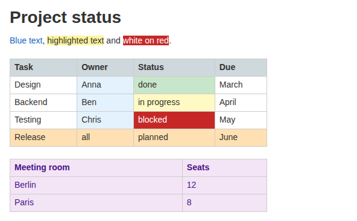
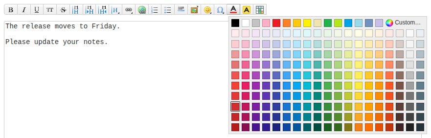
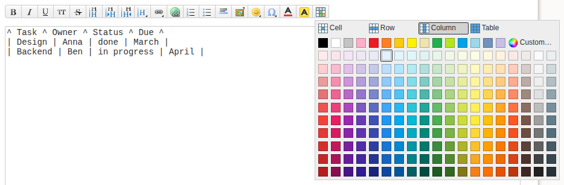

# colorplus

A DokuWiki plugin for colored text, highlighted text and colored tables.







colorplus adds three buttons to the editor toolbar: text color, background color and table colors. Each one opens a palette with over 200 colors, and if none of them fits, "Custom…" opens your browser's color dialog. You can color single table cells, whole rows, whole columns or the entire table, which is the main reason this plugin exists.

## Installation

In your wiki, open Admin, Extension Manager, Manual Install and paste this URL into "Install from URL":

```
https://github.com/LukaWe/dokuwiki-colored-text/archive/refs/heads/main.zip
```

You can also download that zip and upload it on the same page. To install by hand, unpack it into `lib/plugins/colorplus`. The folder has to be named `colorplus`, otherwise DokuWiki won't load it.

colorplus understands the `<color>` syntax of the old color plugin, so pages written for it keep working. You can also keep the color plugin installed. It then renders `<color>` and colorplus takes care of everything else.

Works with DokuWiki 2024-02-06 "Kaos" and later. The toolbar speaks English and German.

## Usage

Select some text, open one of the pickers and click a color. The markup is inserted for you. In the table picker, choose cell, row, column or table at the top first, then click the color while the cursor is in a table cell.

You can of course write the markup yourself. Any CSS color works: `#ff8800`, `orange`, `rgb(255, 136, 0)`.

```
<color #1565c0>Blue text</color>
<color /#fff59d>highlighted text</color>
<color #ffffff/#c62828>white on red</color>
```

The format is `<color text/background>`, either part can be left out. If a color contains a slash, use a colon as separator instead.

For tables, put one of these tags anywhere in a cell:

```
<cellcolor background/text>    the cell
<rowcolor background/text>     the whole row
<colcolor background/text>     the whole column
<tablecolor background/text>   the whole table
```

Note that here the background comes first, the text color is optional. The tables from the first screenshot:

```
^ <rowcolor #cfd8dc> Task ^ <colcolor #e3f2fd> Owner ^ Status ^ Due ^
| Design | Anna | <cellcolor #c8e6c9> done | March |
| Backend | Ben | <cellcolor #fff9c4> in progress | April |
| Testing | Chris | <cellcolor #c62828/#ffffff> blocked | May |
| <rowcolor #ffe0b2> Release | all | planned | June |

^ <tablecolor #f3e5f5/#4a148c> Meeting room ^ Seats ^
| Berlin | 12 |
| Paris | 8 |
```

If several colors hit the same cell, the cell color wins over the row, the row over the column and the column over the table. Column colors work for the first 50 columns.

## Credits

colorplus started out from the [color plugin](https://www.dokuwiki.org/plugin:color) by Christopher Smith and Harald Hanche-Olsen. The palette is the Material Design color palette.

## License

GPL 2, see [LICENSE](LICENSE).
